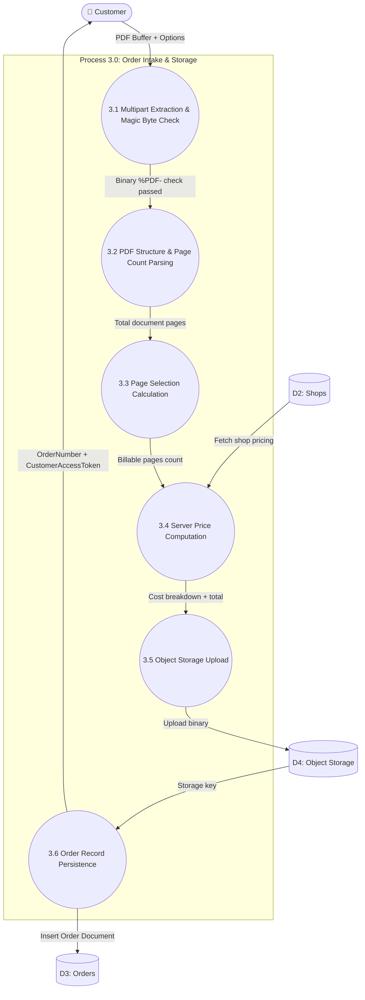

# PrintFlow — Data Flow Diagram (DFD) & Data Architecture

This document provides a formal multi-level **Data Flow Diagram (DFD)** analysis and **Data Dictionary** for **PrintFlow**.

---

## 📑 Table of Contents
1. [Level 0 DFD — Context Diagram](#1-level-0-dfd--context-diagram)
2. [Level 1 DFD — System Overview](#2-level-1-dfd--system-overview)
3. [Level 2 DFD — Subsystem Breakdown](#3-level-2-dfd--subsystem-breakdown)
   - [2.1 Process 1.0: Authentication & Shop Management](#21-process-10-authentication--shop-management)
   - [2.2 Process 2.0: Order Intake & PDF Validation](#22-process-20-order-intake--pdf-validation)
   - [2.3 Process 3.0: Order Lifecycle & Tracking](#23-process-30-order-lifecycle--tracking)
   - [2.4 Process 4.0: Secure Document Access & Retention Cleanup](#24-process-40-secure-document-access--retention-cleanup)
4. [Data Stores & Schema Mapping](#4-data-stores--schema-mapping)
5. [Data Dictionary](#5-data-dictionary)

---

## 1. Level 0 DFD — Context Diagram

The Context Diagram defines the external entities interacting with the PrintFlow system boundaries and the high-level inputs and outputs.

```mermaid
flowchart TD
    Customer(["🧑 Customer (Public)"])
    Shopkeeper(["👨‍💼 Shopkeeper (Authenticated)"])
    StorageProvider(["☁️ Object Storage Provider (S3 / R2)"])
    
    subgraph SystemBoundary ["PrintFlow System (Process 0.0)"]
        PrintFlowSystem(("0.0<br/>PrintFlow Core Engine"))
    end

    %% Customer interactions
    Customer -->|1. Shop Identifier / Slug| PrintFlowSystem
    Customer -->|2. PDF Document + Print Config| PrintFlowSystem
    Customer -->|3. Tracking Token + Order Number| PrintFlowSystem
    PrintFlowSystem -->|4. Shop Profile & Active Rates| Customer
    PrintFlowSystem -->|5. Order Confirmation + Access Token| Customer
    PrintFlowSystem -->|6. Real-time Order Status & Details| Customer

    %% Shopkeeper interactions
    Shopkeeper -->|7. Credentials (Login / Register)| PrintFlowSystem
    Shopkeeper -->|8. Pricing Matrix & Shop Config| PrintFlowSystem
    Shopkeeper -->|9. Order State Changes (Accept/Print/Done)| PrintFlowSystem
    Shopkeeper -->|10. Document Access Request| PrintFlowSystem
    PrintFlowSystem -->|11. JWT Auth Token + Profile| Shopkeeper
    PrintFlowSystem -->|12. Shop Order Queue & Details| Shopkeeper
    PrintFlowSystem -->|13. Time-limited Signed PDF Download URL| Shopkeeper

    %% Storage interactions
    PrintFlowSystem -->|14. PDF Binary Stream (Upload)| StorageProvider
    PrintFlowSystem -->|15. Signed Download / Presigned URL Request| StorageProvider
    PrintFlowSystem -->|16. File Deletion Command (Cleanup)| StorageProvider
    StorageProvider -->|17. Stored Object Key & Status| PrintFlowSystem
    StorageProvider -->|18. Temporary Signed URL| PrintFlowSystem
```

---

## 2. Level 1 DFD — System Overview

Level 1 breaks down the system into its 5 primary processes, 3 data stores, and external entities.

```mermaid
flowchart TD
    %% Entities
    Customer(["🧑 Customer"])
    Shopkeeper(["👨‍💼 Shopkeeper"])
    StorageProvider(["☁️ Object Storage (S3 / R2)"])

    %% Data Stores
    subgraph DataStores ["Data Stores"]
        D1[("D1: Users Collection")]
        D2[("D2: Shops Collection")]
        D3[("D3: Orders Collection")]
        D4[("D4: Object Storage Bucket")]
    end

    %% Processes
    subgraph Processes ["Processes"]
        P1(("1.0<br/>Auth & Shop Management"))
        P2(("2.0<br/>Pricing Engine"))
        P3(("3.0<br/>Order Ingestion & Storage"))
        P4(("4.0<br/>Order Management & Lifecycle"))
        P5(("5.0<br/>Document Access & Retention"))
    end

    %% Process 1 flows
    Shopkeeper -->|Register / Login credentials| P1
    P1 -->|Read / Write Shopkeeper info| D1
    P1 -->|Read / Write Shop profile & rates| D2
    P1 -->|JWT Token + Shop details| Shopkeeper

    %% Process 2 flows
    Customer -->|Print parameters + Shop Slug| P2
    D2 -->|Active pricing matrix| P2
    P2 -->|Calculated unit rates & subtotal| Customer
    P2 -->|Validated pricing snapshot| P3

    %% Process 3 flows
    Customer -->|PDF File + Print Specs| P3
    P3 -->|Store PDF Binary| D4
    D4 -->|Storage Key & Metadata| P3
    P3 -->|Persist Order Document & Metadata| D3
    P3 -->|Order Number + Access Token| Customer

    %% Process 4 flows
    Shopkeeper -->|Fetch Order Queue & Status Updates| P4
    Customer -->|Track Order (Token + Number)| P4
    P4 -->|Read / Update Order state & history| D3
    P4 -->|Order Status View| Customer
    P4 -->|Orders Queue| Shopkeeper

    %% Process 5 flows
    Shopkeeper -->|Request Document to Print| P5
    P5 -->|Verify Shop Ownership & Order| D3
    P5 -->|Request Signed URL| D4
    D4 -->|Signed Temporary URL| P5
    P5 -->|15-minute Signed PDF URL| Shopkeeper
    P5 -->|Delete Expired Documents| D4
    P5 -->|Update isDeleted & statusHistory| D3
```

---

## 3. Level 2 DFD — Subsystem Breakdown

### 2.1 Process 1.0: Authentication & Shop Management

```mermaid
flowchart LR
    Shopkeeper(["👨‍💼 Shopkeeper"])
    
    subgraph P1 ["Process 1.0: Auth & Shop Management"]
        P1_1(("1.1 Validate Credentials & Hash"))
        P1_2(("1.2 Generate JWT Token"))
        P1_3(("1.3 Update Shop Profile"))
        P1_4(("1.4 Update Pricing Matrix"))
        P1_5(("1.5 Toggle Shop Status"))
    end
    
    D1[("D1: Users")]
    D2[("D2: Shops")]
    
    Shopkeeper -->|Credentials| P1_1
    P1_1 <-->|Read / Verify User| D1
    P1_1 -->|User verified| P1_2
    P1_2 -->|JWT Token| Shopkeeper
    
    Shopkeeper -->|Shop profile data| P1_3
    P1_3 -->|Save address/phone| D2
    
    Shopkeeper -->|Pricing config (A4/A3)| P1_4
    P1_4 -->|Save pricing rates| D2
    
    Shopkeeper -->|isOpen (true/false)| P1_5
    P1_5 -->|Set open/closed| D2
```

---

### 2.2 Process 2.0: Order Intake & PDF Validation



---

### 2.3 Process 3.0: Order Lifecycle & Tracking

```mermaid
flowchart TD
    Customer(["🧑 Customer"])
    Shopkeeper(["👨‍💼 Shopkeeper"])
    
    subgraph P4 ["Process 4.0: Order Lifecycle & Tracking"]
        P4_1(("4.1 Customer Order Lookup by Token"))
        P4_2(("4.2 Shopkeeper Queue Query & Filter"))
        P4_3(("4.3 State Transition Validator"))
        P4_4(("4.4 Status History Audit Appender"))
    end
    
    D3[("D3: Orders")]
    
    Customer -->|orderNumber + customerAccessToken| P4_1
    P4_1 <-->|Read order (filter private data)| D3
    P4_1 -->|Customer Safe View| Customer
    
    Shopkeeper -->|Filter: status, search, pagination| P4_2
    P4_2 <-->|Read shop orders (tenant scoped)| D3
    P4_2 -->|Orders Queue List| Shopkeeper
    
    Shopkeeper -->|Change Status: ACCEPTED / PRINTING / COMPLETED| P4_3
    P4_3 <-->|Read current status| D3
    P4_3 -->|Valid state transition| P4_4
    P4_4 -->|Write new status & history log| D3
    P4_4 -->|Confirmation Response| Shopkeeper
```

---

### 2.4 Process 4.0: Secure Document Access & Retention Cleanup

```mermaid
flowchart TD
    Shopkeeper(["👨‍💼 Shopkeeper"])
    SystemCron(["⏰ Maintenance / Scheduled Trigger"])
    
    subgraph P5 ["Process 5.0: Document Access & Retention"]
        P5_1(("5.1 Document Access Authorization"))
        P5_2(("5.2 Presigned URL Generator"))
        P5_3(("5.3 Retention Expiry Evaluator"))
        P5_4(("5.4 Object Storage File Deletion"))
    end
    
    D3[("D3: Orders")]
    D4[("D4: Object Storage")]
    
    Shopkeeper -->|Request document for order ID| P5_1
    P5_1 <-->|Verify shop ownership & !isDeleted| D3
    P5_1 -->|Valid request| P5_2
    P5_2 <-->|Sign GetObject command (15 mins)| D4
    P5_2 -->|Expiring Signed Download URL| Shopkeeper
    
    SystemCron -->|Trigger cleanup routine| P5_3
    P5_3 <-->|Query orders: completed & expired| D3
    P5_3 -->|Expired keys list| P5_4
    P5_4 -->|Delete physical object| D4
    P5_4 -->|Mark isDeleted=true, uploadStatus='DELETED'| D3
```

---

## 4. Data Stores & Schema Mapping

| Data Store ID | Name | Physical Type | Primary Key | Description |
| :--- | :--- | :--- | :--- | :--- |
| **D1** | `users` | MongoDB Collection | `_id` (ObjectId) | Shopkeeper login credentials, password hash, and shop link |
| **D2** | `shops` | MongoDB Collection | `_id` / `slug` | Shop metadata, QR code slug, operational status, and pricing matrix |
| **D3** | `orders` | MongoDB Collection | `_id` / `orderNumber` | Transactional print orders, print configs, pricing snapshots, document metadata |
| **D4** | `documents` | Object Storage (S3 / R2 / Disk) | `storageKey` | Physical binary PDF files stored outside of the database |

---

## 5. Data Dictionary

### Data Entities & Elements

#### 1. `Shop`
- `_id`: Unique database identifier.
- `name`: Business name of the photocopy shop.
- `slug`: Unique, URL-safe string used in customer QR codes (e.g., `campus-print-hub-8a3f`).
- `publicIdentifier`: Indexed identifier for shop lookup.
- `ownerId`: Reference ID pointing to the shopkeeper `User`.
- `isOpen`: Boolean flag indicating if the shop accepts new customer submissions.
- `pricing`: Matrix defining per-sheet rates:
  - `A4.BLACK_WHITE`: `{ single: Number, double: Number }`
  - `A4.COLOR`: `{ single: Number, double: Number }`
  - `A3.BLACK_WHITE`: `{ single: Number, double: Number }`
  - `A3.COLOR`: `{ single: Number, double: Number }`

#### 2. `User` (Shopkeeper)
- `_id`: Unique user identifier.
- `name`: Shopkeeper's full name.
- `email`: Unique lowercase email address.
- `password`: Salted and hashed password string (bcrypt, 10 rounds).
- `shopId`: Reference ID pointing to the associated `Shop`.
- `role`: Role string (`'SHOPKEEPER'`).

#### 3. `Order`
- `_id`: Unique database identifier.
- `orderNumber`: Human-readable order code (e.g., `PF-20261006-8A3F10`).
- `customerAccessToken`: 48-character cryptographic random token for customer tracking.
- `shopId`: Reference ID pointing to the target `Shop`.
- `customerPhone`: Contact number for pickup notifications.
- `document`:
  - `storageKey`: Relative path/key in object storage (e.g., `shops/123/orders/1728203000.pdf`).
  - `originalName`: Original uploaded file name.
  - `mimeType`: Fixed at `'application/pdf'`.
  - `fileSizeBytes`: Total size of the file in bytes.
  - `totalPages`: Total page count extracted from PDF structure.
  - `uploadedAt`: Timestamp of upload.
  - `expiresAt`: Computed timestamp for retention deletion (`uploadedAt + DOC_RETENTION_HOURS`).
  - `uploadStatus`: Enum (`'PENDING'`, `'UPLOADED'`, `'DELETED'`).
  - `isDeleted`: Boolean flag set to true after retention cleanup.
- `printConfig`:
  - `copies`: Number of physical copies ($\ge 1$).
  - `paperSize`: Enum (`'A4'`, `'A3'`, `'LEGAL'`, `'LETTER'`).
  - `printType`: Enum (`'BLACK_WHITE'`, `'COLOR'`).
  - `printSides`: Enum (`'SINGLE'`, `'DOUBLE'`).
  - `pageSelection`: `{ type: 'ALL'|'RANGE'|'CUSTOM'|'ODD'|'EVEN', customValue: String }`.
  - `pagesToPrintCount`: Calculated printable pages per copy.
  - `pageNumbers`: Array of exact page numbers to print.
- `pricing`:
  - `unitRates`: Applied rates `{ single, double }`.
  - `costPerCopy`: Cost per copy.
  - `totalAmount`: Total order price (`costPerCopy * copies`).
  - `currency`: Default `'INR'`.
- `status`: Lifecycle state (`'SUBMITTED'`, `'ACCEPTED'`, `'PRINTING'`, `'COMPLETED'`, `'REJECTED'`, `'CANCELLED'`).
- `statusHistory`: Array of audit entries:
  - `status`: State transitioned to.
  - `changedAt`: Timestamp of transition.
  - `changedBy`: Entity initiating transition (`'CUSTOMER'`, `'SHOPKEEPER'`, `'SYSTEM'`).
  - `note`: Context or reason for transition.
