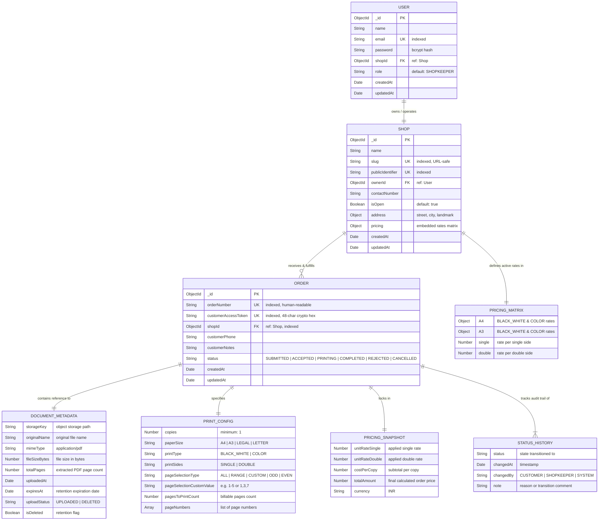

# PrintFlow — Entity-Relationship (ER) Diagram & Database Schema

This document details the **Entity-Relationship (ER) Diagram**, data models, relationships, field constraints, and indexing strategy for **PrintFlow**.

---

## 📑 Table of Contents
1. [Visual Entity-Relationship Diagram](#1-visual-entity-relationship-diagram)
2. [Entity Definitions & Cardinality](#2-entity-definitions--cardinality)
3. [Detailed Entity Schemas](#3-detailed-entity-schemas)
   - [3.1 USER (Shopkeeper)](#31-user-shopkeeper)
   - [3.2 SHOP](#32-shop)
   - [3.3 ORDER](#33-order)
   - [3.4 Embedded Structures](#34-embedded-structures)
4. [Indexes & Query Optimization](#4-indexes--query-optimization)
5. [Logical vs Physical Storage Architecture](#5-logical-vs-physical-storage-architecture)

---

## 1. Visual Entity-Relationship Diagram



---

## 2. Entity Definitions & Cardinality

| Relationship | Cardinality | Enforced By | Description |
| :--- | :--- | :--- | :--- |
| **USER $\rightarrow$ SHOP** | **1 : 1** | `user.shopId` & `shop.ownerId` | Each registered shopkeeper owns exactly one photocopy shop profile in V1. |
| **SHOP $\rightarrow$ ORDER** | **1 : N** | `order.shopId` Index | A shop receives zero or many incoming customer print orders. |
| **ORDER $\rightarrow$ DOCUMENT** | **1 : 1** | Embedded in `Order` | Each order references exactly one PDF document stored in object storage. |
| **ORDER $\rightarrow$ PRINT_CONFIG** | **1 : 1** | Embedded in `Order` | Each order encapsulates the customer's printing specifications. |
| **ORDER $\rightarrow$ PRICING_SNAPSHOT**| **1 : 1** | Embedded in `Order` | Immutable pricing rates locked in at the time of order creation. |
| **ORDER $\rightarrow$ STATUS_HISTORY** | **1 : N** | Embedded Array | An order maintains an append-only audit trail of every status transition. |

---

## 3. Detailed Entity Schemas

### 3.1 USER (Shopkeeper)
*Collection: `users`*

| Field | Type | Required | Unique | Indexed | Description |
| :--- | :--- | :---: | :---: | :---: | :--- |
| `_id` | `ObjectId` | Yes | Yes | Primary | Auto-generated document ID |
| `name` | `String` | Yes | No | No | Shopkeeper's display name |
| `email` | `String` | Yes | Yes | Yes | Unique login email (stored lowercase) |
| `password` | `String` | Yes | No | No | Hashed using bcrypt (10 rounds, hidden in queries) |
| `shopId` | `ObjectId` | No | No | Yes | Reference to `Shop._id` |
| `role` | `String` | Yes | No | No | Defaults to `'SHOPKEEPER'` |
| `createdAt` | `Date` | Yes | No | No | Mongoose auto timestamp |
| `updatedAt` | `Date` | Yes | No | No | Mongoose auto timestamp |

---

### 3.2 SHOP
*Collection: `shops`*

| Field | Type | Required | Unique | Indexed | Description |
| :--- | :--- | :---: | :---: | :---: | :--- |
| `_id` | `ObjectId` | Yes | Yes | Primary | Auto-generated document ID |
| `name` | `String` | Yes | No | No | Business name of the printing shop |
| `slug` | `String` | Yes | Yes | Yes | URL-safe identifier for QR code URLs |
| `publicIdentifier` | `String` | Yes | Yes | Yes | Public ID for shop discovery |
| `ownerId` | `ObjectId` | Yes | No | Yes | Reference to `User._id` |
| `contactNumber` | `String` | No | No | No | Shop contact phone |
| `address` | `Object` | No | No | No | Embedded `{ street, city, landmark }` |
| `isOpen` | `Boolean` | Yes | No | No | Operational toggle (default: `true`) |
| `pricing` | `Object` | Yes | No | No | Embedded pricing matrix for A4/A3 |
| `createdAt` | `Date` | Yes | No | No | Mongoose auto timestamp |
| `updatedAt` | `Date` | Yes | No | No | Mongoose auto timestamp |

---

### 3.3 ORDER
*Collection: `orders`*

| Field | Type | Required | Unique | Indexed | Description |
| :--- | :--- | :---: | :---: | :---: | :--- |
| `_id` | `ObjectId` | Yes | Yes | Primary | Auto-generated document ID |
| `orderNumber` | `String` | Yes | Yes | Yes | Human-readable identifier (e.g., `PF-20261006-8A3F10`) |
| `customerAccessToken` | `String` | Yes | Yes | Yes | 48-char crypto hex string for customer tracking |
| `shopId` | `ObjectId` | Yes | No | Yes | Reference to `Shop._id` (tenant scoping) |
| `customerPhone` | `String` | No | No | No | Optional phone for order pickup |
| `customerNotes` | `String` | No | No | No | Special printing / binding instructions |
| `document` | `Object` | Yes | No | No | Embedded document metadata *(see 3.4.1)* |
| `printConfig` | `Object` | Yes | No | No | Embedded print configuration *(see 3.4.2)* |
| `pricing` | `Object` | Yes | No | No | Embedded pricing snapshot *(see 3.4.3)* |
| `status` | `String` | Yes | No | Yes | Enum: `SUBMITTED`, `ACCEPTED`, `PRINTING`, `COMPLETED`, `REJECTED`, `CANCELLED` |
| `statusHistory` | `Array` | Yes | No | No | Array of status audit entries *(see 3.4.4)* |
| `createdAt` | `Date` | Yes | No | No | Order creation timestamp |
| `updatedAt` | `Date` | Yes | No | No | Last update timestamp |

---

### 3.4 Embedded Structures

#### 3.4.1 `document` (Metadata Sub-document)
*Embedded inside `Order` (PDF binary remains in Object Storage)*
- `storageKey` (`String`, required): Unique object storage path (e.g. `shops/66f.../orders/1728203000-a4.pdf`).
- `originalName` (`String`, required): Original uploaded filename.
- `mimeType` (`String`, default: `'application/pdf'`): Content type.
- `fileSizeBytes` (`Number`, required): Exact file size in bytes.
- `totalPages` (`Number`, required): Total page count verified via `pdf-lib`.
- `uploadedAt` (`Date`, default: `Date.now`): Upload timestamp.
- `expiresAt` (`Date`): Timestamp when document is eligible for automated deletion.
- `uploadStatus` (`String`, enum: `['PENDING', 'UPLOADED', 'DELETED']`): Physical file status.
- `isDeleted` (`Boolean`, default: `false`): True if physically deleted from storage.

#### 3.4.2 `printConfig` (Print Options Sub-document)
- `copies` (`Number`, min: 1, default: 1): Physical sets to print.
- `paperSize` (`String`, enum: `['A4', 'A3', 'LEGAL', 'LETTER']`): Paper size.
- `printType` (`String`, enum: `['BLACK_WHITE', 'COLOR']`): Ink mode.
- `printSides` (`String`, enum: `['SINGLE', 'DOUBLE']`): Duplex mode.
- `pageSelection.type` (`String`, enum: `['ALL', 'RANGE', 'CUSTOM', 'ODD', 'EVEN']`): Page strategy.
- `pageSelection.customValue` (`String`): Range or list value (e.g. `"1-5"` or `"1,3,7"`).
- `pagesToPrintCount` (`Number`): Billable pages count per copy.
- `pageNumbers` (`[Number]`): Array of exact page numbers.

#### 3.4.3 `pricing` (Pricing Snapshot Sub-document)
- `unitRates.single` (`Number`): Rate applied per single-sided sheet.
- `unitRates.double` (`Number`): Rate applied per double-sided sheet.
- `costPerCopy` (`Number`): Calculated cost per copy.
- `totalAmount` (`Number`): Total order cost (`costPerCopy * copies`).
- `currency` (`String`, default: `'INR'`): Currency code.

#### 3.4.4 `statusHistory` (Audit Trail Sub-document Array)
- `status` (`String`, required): State transitioned into.
- `changedAt` (`Date`, default: `Date.now`): Transition timestamp.
- `changedBy` (`String`, enum: `['CUSTOMER', 'SHOPKEEPER', 'SYSTEM']`): Actor.
- `note` (`String`): Audit explanation.

---

## 4. Indexes & Query Optimization

| Collection | Indexed Field(s) | Index Type | Purpose |
| :--- | :--- | :--- | :--- |
| `users` | `email` | **Unique** | Fast login lookup & duplicate prevention |
| `shops` | `slug` | **Unique** | Instant QR code scan resolution |
| `shops` | `publicIdentifier` | **Unique** | Public shop discovery |
| `shops` | `ownerId` | Standard | Retrieve shop by authenticated shopkeeper |
| `orders` | `orderNumber` | **Unique** | Fast customer & shopkeeper order lookup |
| `orders` | `customerAccessToken` | **Unique** | Unguessable customer tracking token lookup |
| `orders` | `shopId` + `status` | **Compound** | Filter active/pending shop queue |
| `orders` | `shopId` + `createdAt` | **Compound** | Paginated shop dashboard sorting (newest first) |
| `orders` | `status` + `document.expiresAt` + `document.isDeleted` | **Compound** | Efficient document retention cleanup query |

---

## 5. Logical vs Physical Storage Architecture

```
┌────────────────────────────────────────────────────────────────────────┐
│                        MongoDB Atlas Database                          │
│                                                                        │
│   ┌────────────────────┐   ┌────────────────────┐   ┌──────────────┐   │
│   │  users collection  │   │  shops collection  │   │    orders    │   │
│   │                    │   │                    │   │  collection  │   │
│   │ • credentials hash │   │ • pricing matrix   │   │ • metadata   │   │
│   │ • shop link        │   │ • slug / QR info   │   │ • pricing    │   │
│   └────────────────────┘   └────────────────────┘   │ • statuses   │   │
│                                                     └──────┬───────┘   │
└────────────────────────────────────────────────────────────┼───────────┘
                                                             │
                                                  storageKey │ (Pointer)
                                                             ▼
┌────────────────────────────────────────────────────────────────────────┐
│                   Object Storage Layer (S3 / R2)                       │
│                                                                        │
│   Bucket: printflow-documents                                          │
│   Key: shops/{shopId}/orders/{timestamp}-{randomHex}.pdf               │
│                                                                        │
│   * Binary PDF data stored ONLY in object storage                      │
│   * Accessed ONLY via short-lived signed URLs (15 min)                 │
│   * Deleted automatically when retention period expires                │
└────────────────────────────────────────────────────────────────────────┘
```
