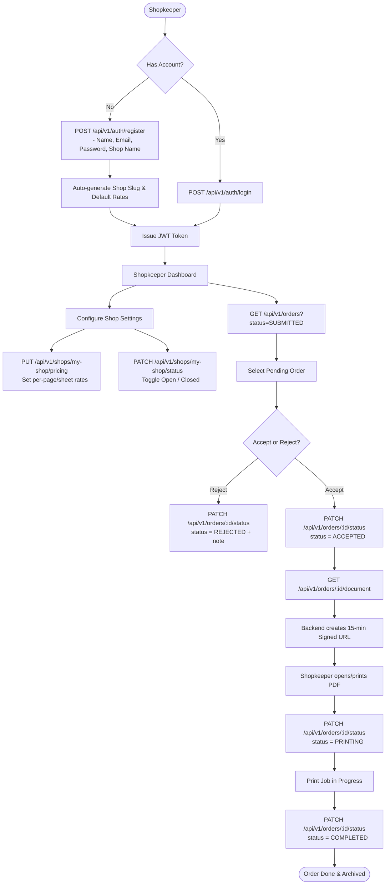
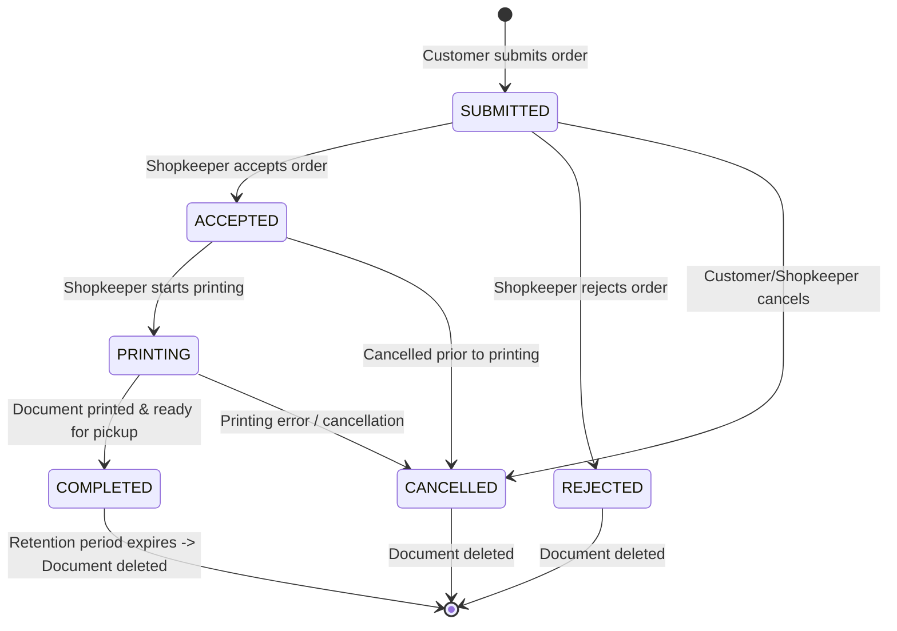

# PrintFlow — System Flowchart & Architecture Workflows

This document outlines the operational flowcharts, user journeys, state transition flows, and backend logic flows for **PrintFlow**.

---

## 📑 Table of Contents
1. [End-to-End System Master Flow](#1-end-to-end-system-master-flow)
2. [Customer Journey Flowchart](#2-customer-journey-flowchart)
3. [Shopkeeper Workflow Flowchart](#3-shopkeeper-workflow-flowchart)
4. [Backend PDF Processing & Pricing Validation Flow](#4-backend-pdf-processing--pricing-validation-flow)
5. [Order Lifecycle State Machine Flow](#5-order-lifecycle-state-machine-flow)
6. [Secure Document Access & Retention Cleanup Flow](#6-secure-document-access--retention-cleanup-flow)

---

## 1. End-to-End System Master Flow

```mermaid
flowchart TD
    subgraph Customer [Customer (No Account Required)]
        A[Scan Shop QR Code] --> B[Open Shop Webpage via Slug]
        B --> C[Upload PDF Document]
        C --> D[Select Print Configuration]
        D --> E[Preview Calculated Price]
        E --> F[Submit Order]
        F --> G[Receive Order Number & Tracking Token]
        G --> H[Track Live Status on Webpage]
    end

    subgraph Backend [PrintFlow Backend Engine]
        F --> I[Validate PDF Magic Bytes & Page Count]
        I --> J[Store PDF in Object Storage S3/R2/Local]
        J --> K[Calculate Exact Price via Shop Rates]
        K --> L[Persist Order in MongoDB]
        L --> G
    end

    subgraph Shopkeeper [Shopkeeper Dashboard (JWT Auth)]
        M[Login / Authenticate] --> N[View Live Orders Queue]
        N --> O{Review Order}
        O -- Reject --> P[Mark Order as REJECTED]
        O -- Accept --> Q[Mark Order as ACCEPTED]
        Q --> R[Download/View PDF via Signed URL]
        R --> S[Mark Order as PRINTING]
        S --> T[Physical Print Completed]
        T --> U[Mark Order as COMPLETED]
    end

    L -.->|Appears in Queue| N
    P -.->|Real-time update| H
    Q -.->|Real-time update| H
    S -.->|Real-time update| H
    U -.->|Real-time update| H
```

---

## 2. Customer Journey Flowchart

```mermaid
flowchart TD
    Start([Customer at Shop]) --> ScanQR[Scan QR Code on Shop Counter]
    ScanQR --> FetchShop[GET /api/v1/shops/public/:slug]
    
    FetchShop --> IsOpenCheck{Is Shop Open?}
    IsOpenCheck -- No --> ClosedScreen[Display 'Shop Closed' Notice]
    IsOpenCheck -- Yes --> SelectDoc[Select & Upload PDF Document]
    
    SelectDoc --> ConfigurePrint[Configure Print Options:
    - Copies count (>= 1)
    - Paper size (A4 / A3)
    - Print type (B&W / Color)
    - Sides (Single / Double)
    - Pages (ALL / RANGE / CUSTOM / ODD / EVEN)]
    
    ConfigurePrint --> PreviewPrice[POST /api/v1/orders/calculate-price
    Preview dynamic cost estimate]
    
    PreviewPrice --> SubmitOrder[POST /api/v1/orders (Multipart form)]
    
    SubmitOrder --> ServerValidation{Server Validation & Binary PDF Check}
    ServerValidation -- Invalid (Bad PDF / closed shop) --> ErrorAlert[Show Error Message]
    ErrorAlert --> ConfigurePrint
    
    ServerValidation -- Valid --> SaveDB[Order Persisted in MongoDB]
    SaveDB --> StoreFile[PDF Uploaded to Object Storage]
    StoreFile --> RetResponse[Return Order Number + Customer Access Token]
    
    RetResponse --> TrackView[Customer Tracking Dashboard
    GET /api/v1/orders/track/:orderNumber?token=...]
    
    TrackView --> WaitPickup[Wait for Status: COMPLETED -> Collect Prints & Pay]
    WaitPickup --> End([Done])
```

---

## 3. Shopkeeper Workflow Flowchart



---

## 4. Backend PDF Processing & Pricing Validation Flow

```mermaid
flowchart TD
    IncomingReq([Incoming POST /api/v1/orders Request]) --> CheckFile{File present in multipart?}
    CheckFile -- No --> Err400A[Throw ApiError 400: PDF file is required]
    
    CheckFile -- Yes --> ShopCheck[Query MongoDB for Shop by Slug]
    ShopCheck --> ShopExists{Shop exists & isOpen == true?}
    ShopExists -- No --> Err400B[Throw ApiError 400: Shop closed or not found]
    
    ShopExists -- Yes --> MagicBytes[Inspect binary header: 0x25 0x50 0x44 0x46 (%PDF-)]
    MagicBytes --> HeaderValid{Valid PDF Magic Bytes?}
    HeaderValid -- No --> Err400C[Throw ApiError 400: Not a valid PDF binary]
    
    HeaderValid -- Yes --> ParsePDF[pdf-lib loads buffer & extracts totalPages]
    ParsePDF --> ExtractPages{Total pages > 0?}
    ExtractPages -- No --> Err400D[Throw ApiError 400: Corrupted PDF]
    
    ExtractPages -- Yes --> CalcPages[Calculate Page Selection:
    - ALL -> 1..N
    - RANGE -> parse 'X-Y'
    - CUSTOM -> parse '1,3,7'
    - ODD / EVEN -> filter pages]
    
    CalcPages --> CheckBounds{All pages <= totalPages?}
    CheckBounds -- No --> Err400E[Throw ApiError 400: Page out of bounds]
    
    CheckBounds -- Yes --> PricingEngine[Pricing Engine:
    Look up Shop.pricing for PaperSize + PrintType
    Single: pages * rate.single
    Double: floor(pages/2)*rate.double + (pages%2)*rate.single
    Total = CostPerCopy * copies]
    
    PricingEngine --> UploadStorage[IStorageService.uploadFile
    Save to S3 / Cloudflare R2 / Local Disk]
    
    UploadStorage --> GenTokens[Generate OrderNumber (PF-YYYYMMDD-XXX)
    Generate CustomerAccessToken (48-char crypto hex)
    Set expiresAt = now + DOC_RETENTION_HOURS]
    
    GenTokens --> InsertOrder[Insert Order Document into MongoDB]
    InsertOrder --> SuccessRes([Return 201 Response with Tracking Metadata])
```

---

## 5. Order Lifecycle State Machine Flow



---

## 6. Secure Document Access & Retention Cleanup Flow

```mermaid
flowchart TD
    subgraph DocumentAccessFlow [Secure Document Access Flow]
        Req[Shopkeeper / Customer requests document] --> AuthCheck{Authorized?}
        AuthCheck -- No --> Deny[401/403 Access Denied]
        AuthCheck -- Yes --> CheckDeleted{Is document deleted?}
        CheckDeleted -- Yes --> Ret410[410 Gone: Document expired]
        CheckDeleted -- No --> GenPresigned[Storage Service generates time-limited Signed URL]
        GenPresigned --> StreamOrRedirect[Serve document securely for 15 minutes]
    end

    subgraph RetentionCleanupFlow [Automated Retention Cleanup Flow]
        Trigger([Cron / Maintenance Trigger]) --> QueryExpired[Find orders where status in [COMPLETED, REJECTED, CANCELLED] AND expiresAt <= Now AND isDeleted == false]
        QueryExpired --> LoopOrders{For each expired order}
        LoopOrders --> DeleteObject[StorageService.deleteFile(storageKey)]
        DeleteObject --> UpdateDoc[Set isDeleted = true, uploadStatus = 'DELETED']
        UpdateDoc --> RecordAudit[Append SYSTEM audit log to statusHistory]
        RecordAudit --> LoopOrders
        LoopOrders --> FinishCleanup([Cleanup finished])
    end
```
